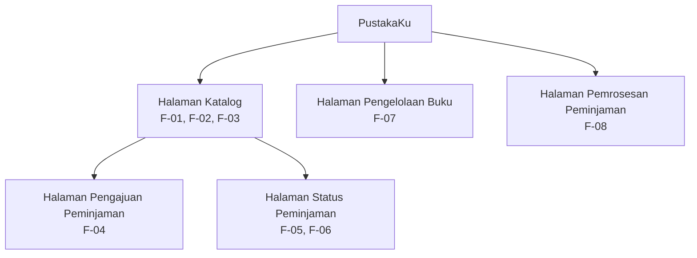

Information Architecture — PustakaKu
1. Deskripsi Singkat
PustakaKu adalah aplikasi perpustakaan kampus yang membantu mahasiswa melihat katalog, mencari buku, memeriksa ketersediaan, mengajukan peminjaman, dan memantau status peminjaman. Petugas perpustakaan menggunakan aplikasi untuk mengelola data buku dan memproses pengajuan peminjaman.
Catatan konsistensi: ID kebutuhan di bawah mengikuti draf kebutuhan PustakaKu yang telah disusun sebelumnya. Cocokkan kembali ID dan nama layar dengan tabel pemetaan pada dokumen-kebutuhan.md Tugas 4 sebelum dikumpulkan.

2. Inventaris Layar
No.	Nama layar	Pengguna	Kebutuhan yang dipenuhi	Fungsi utama
1	Halaman Katalog	Mahasiswa	F-01, F-02, F-03	Menampilkan katalog buku, menyediakan pencarian berdasarkan judul atau penulis, dan menampilkan ketersediaan buku.
2	Halaman Pengajuan Peminjaman	Mahasiswa	F-04	Memungkinkan mahasiswa mengajukan peminjaman buku yang tersedia dan memperoleh status awal pengajuan.
3	Halaman Status Peminjaman	Mahasiswa	F-05, F-06	Menampilkan riwayat/status peminjaman serta informasi tenggat pengembalian.
4	Halaman Pengelolaan Buku	Petugas perpustakaan	F-07	Memungkinkan petugas menambah atau memperbarui data buku dan stok.
5	Halaman Pemrosesan Peminjaman	Petugas perpustakaan	F-08	Memungkinkan petugas memeriksa dan memproses pengajuan peminjaman mahasiswa.

3. Diagram Information Architecture

4. Layar Utama
Halaman Katalog dipilih sebagai layar utama karena menjadi titik awal mahasiswa untuk melihat daftar buku, mencari buku berdasarkan judul atau penulis, dan memeriksa ketersediaan. Layar ini mendukung F-01, F-02, dan F-03, sehingga membantu mahasiswa menentukan buku yang ingin dipinjam sebelum mengajukan peminjaman.
5. Cakupan Wireframe Tugas 5
Wireframe minimal akan memuat dua layar:
1. Halaman Katalog — layar utama, berisi judul halaman, kolom pencarian, daftar buku, dan aksi utama.
2. Halaman Status Peminjaman — layar pendukung, menampilkan contoh status Menunggu dan informasi tenggat pengembalian.
Wireframe menggunakan gaya low-fidelity. Setiap area diberi anotasi fungsi dan ID kebutuhan yang sesuai. Implementasi halaman-utama.dart berfokus pada Halaman Katalog dan tidak menggunakan Navigator, sesuai batas cakupan Pertemuan 5.