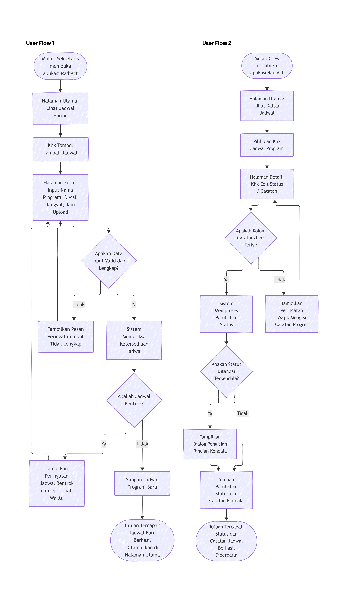

# Tugas 4: Dokumen Kebutuhan dan User Flow

**Nama**  : Deyna Angeliawati Zahara  
**NPM**   : 230660221032  
**Kelas** : SI VII B 

## 1. Komponen Tugas
- Deskripsi Aplikasi
- User Persona
- Kebutuhan Fungsional dan Nonfungsional
- Prioritas Fitur
- Pemetaan Kebutuhan ke Antarmuka

Terdapat Pada Dokumen Kebutuhan: [dokumen-kebutuhan.md](dokumen-kebutuhan.md)

User Flow Terdapat pada Gambar Berikut:  

Untuk lebih jelasnya tertera pada Dokumen [user-flow.md](user-flow.md). 

## 2. Refleksi
Bagian analisis yang paling sulit ditetapkan adalah rumusan kebutuhan, karena seluruh fungsi sistem harus teridentifikasi secara tepat tanpa ada yang terlewat. Proses ini menuntut ketelitian tinggi dalam menyelaraskan masalah nyata organisasi dengan fitur aplikasi yang benar-benar mendesak. Meskipun menantang, tahap ini sangat krusial agar prioritas kebutuhan yang disusun dalam skema MoSCoW dapat mencerminkan solusi yang efektif dan tepat sasaran.

## 3. Struktur Folder Pengumpulan
```text
tugas4_Deyna/
├── dokumen-kebutuhan.md
├── README.md
├── user-flow.md
└── user-flow.png