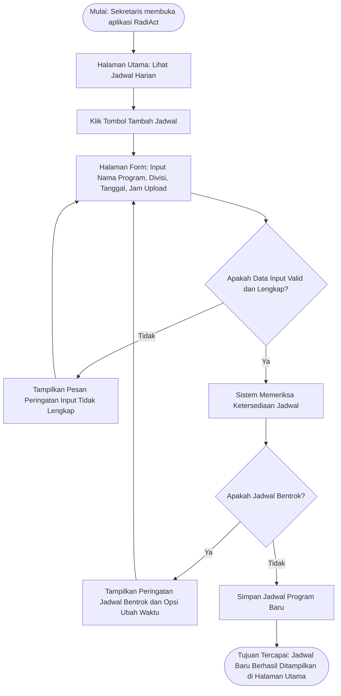
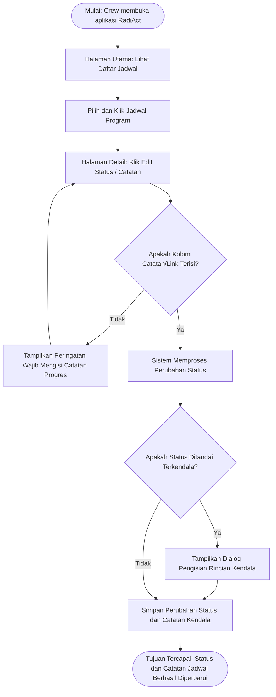

# Dokumen User Flow — Aplikasi RadiAct

## User Flow 1
### 1. Identitas Alur

| Aspek | Isi |
|:---|:---|
| **Nama alur** | Menambahkan Jadwal Program Baru dan Penanganan Bentrok Jadwal |
| **Aktor** | Persona 3 — (Sekretaris Umum) |
| **Tujuan alur** | Berhasil membuat jadwal program baru atau menyesuaikan jadwal yang mengalami bentrokan hingga berhasil disimpan |

### 2. Diagram User Flow

### 3. Diagram Langkah

| No. | Jenis | Langkah/Halaman | Bila gagal |
|:---|:---|:---|:---|
| 1 | Mulai | Sekretaris membuka aplikasi RadiAct | — |
| 2 | Halaman | Menampilkan Halaman Utama (Daftar Jadwal Harian) | — |
| 3 | Proses | Memilih tombol "Tambah Jadwal" | — |
| 4 | Halaman | Menampilkan Form Tambah Jadwal dan mengisi detail (Nama Program, Divisi, Tanggal, Jam Upload) | — |
| 5 | Keputusan | Apakah Data Input Valid dan Lengkap? | Kembali ke Form Tambah Jadwal dengan pesan peringatan agar melengkapi formulir |
| 6 | Proses | Sistem melakukan verifikasi ketersediaan slot jadwal | — |
| 7 | Keputusan | Apakah Jadwal Bentrok dengan Divisi Lain? | Kembali ke Form Tambah Jadwal dengan notifikasi bentrok untuk memilih ulang jam/hari |
| 8 | Proses | Sistem menyimpan data jadwal program baru | — |
| 9 | Tujuan | Tujuan Tercapai: Jadwal baru berhasil ditambahkan dan langsung memperbarui daftar di Halaman Utama | — |

# User Flow 2 

## 1. Identitas Alur

| Aspek | Isi |
|:---|:---|
| **Nama alur** | Memperbarui Status Progres Program dan Catatan Kendala |
| **Aktor** | Persona 1 (Kadiv Inti) dan Persona 2 (Kadiv MarCom) |
| **Tujuan alur** | Berhasil mengubah status  konten dan menambahkan catatan/link pengerjaan |

## 2. Diagram User Flow

## 3. Daftar Langkah

| No. | Jenis | Langkah/Halaman | Bila gagal |
|:---|:---|:---|:---|
| 1 | Mulai | Crew membuka aplikasi RadiAct | — |
| 2 | Halaman | Menampilkan Halaman Utama (Daftar Jadwal Harian) | — |
| 3 | Proses | Memilih salah satu jadwal program | — |
| 4 | Halaman | Menampilkan Halaman Detail dan memilih opsi edit status/catatan | — |
| 5 | Keputusan | Apakah Kolom Catatan/Link Terisi? | Kembali ke Form Edit dengan pesan peringatan agar mengisi catatan/tautan progres |
| 6 | Proses | Sistem memproses pembaruan status (Progres / Terkendala / Tayang) | — |
| 7 | Keputusan | Apakah Status Ditandai "Terkendala"? | Menampilkan dialog pengisian rincian kendala untuk ditinjau oleh Sekretaris Umum |
| 8 | Proses | Sistem menyimpan status dan catatan terbaru | — |
| 9 | Tujuan | Tujuan Tercapai: Status dan catatan progres jadwal berhasil diperbarui di Halaman Utama | — |