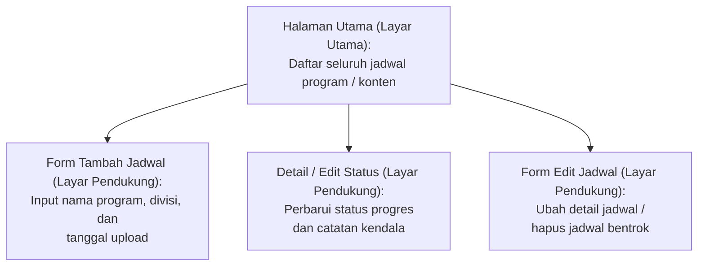

# Information Architecture (IA) — RadiAct

## 1. Inventaris Layar

| Layar yang Memenuhi | ID Kebutuhan yang Dipenuhi | Rumusan Kebutuhan | Prioritas |
|:---|:---|:---|:---:|
| **Halaman Utama** | **F-01**, **F-04**, **F-06** | Melihat daftar seluruh jadwal program dan statusnya, memfilter jadwal berdasarkan divisi, serta melihat header sapaan dan ringkasan total program | Must / Should |
| **Form Tambah Jadwal** | **F-02** | Menambahkan jadwal program atau konten baru | Must |
| **Detail / Dialog Edit Status** | **F-03** | Memperbarui status progres dan catatan kendala | Must |
| **Form Edit / Detail Jadwal** | **F-05** | Mengubah tanggal/jam atau menghapus jadwal bentrok | Could |

## 2. Diagram Information Architecture

## 3. Alasan Pemilihan Layar Utama
Halaman Utama dipilih sebagai layar utama (root) karena memenuhi kebutuhan mendesak dengan prioritas (Must) yaitu F-01 (melihat seluruh daftar jadwal program/konten) dan F-06 (melihat header sapaan dan ringkasan status progres harian). Layar ini menjadi pusat informasi operasional harian bagi seluruh crew UKM Radio sekaligus titik masuk utama (entry point) untuk mengakses seluruh fitur dan layar pendukung lainnya.