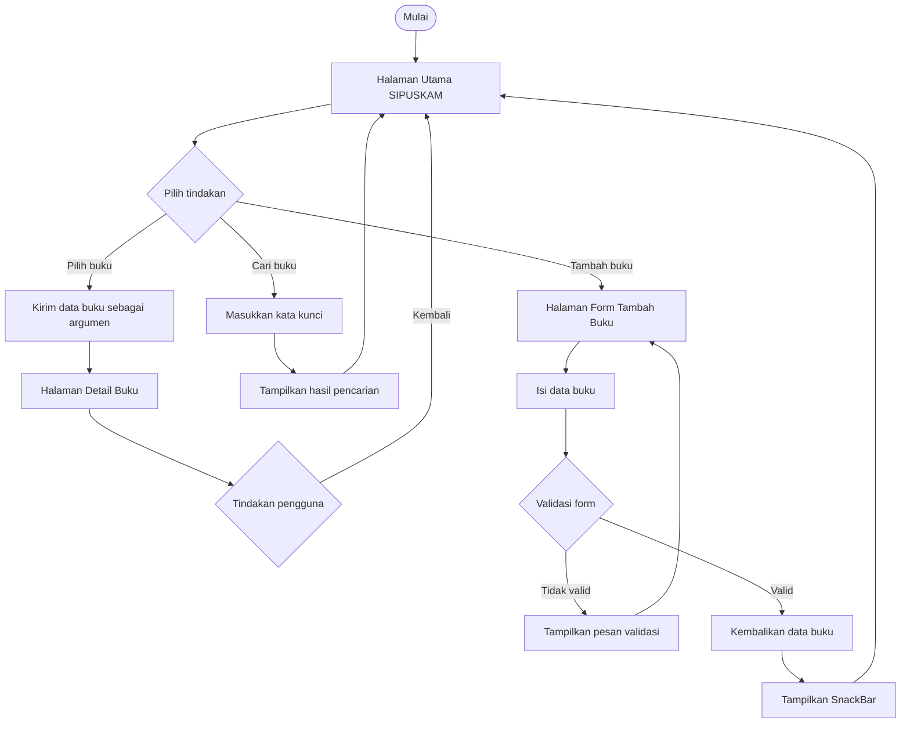

# Navigation Flow SIPUSKAM

## 1. Deskripsi Aplikasi

SIPUSKAM merupakan aplikasi perpustakaan kampus yang membantu pengguna melihat daftar buku, mencari buku berdasarkan informasi yang tersedia, melihat detail buku, dan menambahkan data buku baru.

## 2. Tabel Navigasi

| Nama Route | Halaman | Kebutuhan Terkait | Keterangan |
|---|---|---|---|
| `/` | Halaman Utama | F-01, F-03 | Menampilkan daftar buku dan pencarian |
| `/detail-buku` | Detail Buku | F-02 | Menampilkan informasi buku yang dipilih |
| `/tambah-buku` | Tambah Buku | F-04 | Menampilkan form penambahan buku |

Route awal aplikasi adalah `/`, sehingga pengguna langsung diarahkan ke halaman utama SIPUSKAM ketika membuka aplikasi.

## 3. Diagram Alur Navigasi

## 4. Mekanisme Navigasi

- `MaterialApp.routes` mendefinisikan rute halaman aplikasi.
- `Navigator.pushNamed()` membuka halaman detail atau form tambah buku.
- Argumen navigasi digunakan untuk mengirim data buku yang dipilih ke halaman detail.
- `Navigator.pop()` mengembalikan pengguna ke halaman sebelumnya dan dapat membawa hasil dari form.
- `Form`, `GlobalKey<FormState>`, dan `validator` digunakan untuk memeriksa masukan pengguna.
- `SnackBar` digunakan untuk memberikan umpan balik setelah proses penyimpanan berhasil.

## 5. Penanganan Kondisi

| Kondisi | Respons |
|---|---|
| Buku dipilih | Sistem membuka halaman detail dengan data buku yang dipilih |
| Argumen tidak sesuai | Sistem menangani data yang tidak valid atau tidak tersedia |
| Form tidak valid | Sistem menampilkan pesan validasi |
| Form valid | Data buku dikembalikan ke halaman sebelumnya |
| Penyimpanan berhasil | Sistem menampilkan SnackBar dan memperbarui daftar sesuai implementasi aplikasi |

## 6. Kesimpulan

Alur navigasi SIPUSKAM menghubungkan halaman utama, detail buku, dan form tambah buku. Navigasi, pengiriman argumen, validasi form, dan umpan balik dirancang agar interaksi pengguna berlangsung secara terstruktur.