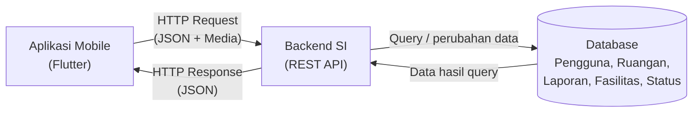

# Tugas 1 — Identifikasi Kebutuhan Aplikasi Bergerak

**Judul Project:** Sistem Pelaporan Kerusakan Fasilitas Fakultas Teknologi Informasi
**Nama:** Marsya Anastasya
**NIM:** 230660221100

## 1. Domain Sistem Informasi

**Sistem Pelaporan Kerusakan Fasilitas Fakultas Teknologi Informasi**

Sistem ini berfokus pada pelaporan kerusakan atau permasalahan fasilitas di lingkungan Fakultas Teknologi Informasi. Pelapor terdiri dari mahasiswa dan dosen, sedangkan petugas fasilitas bertugas menerima, menangani, dan memperbarui status laporan. Fasilitas yang dapat dilaporkan meliputi AC, proyektor, kursi, lampu, serta fasilitas lainnya yang dapat ditambahkan secara manual.

## 2.1 Deskripsi Sistem

Sistem Pelaporan Kerusakan Fasilitas Fakultas Teknologi Informasi merupakan sistem informasi berbasis mobile yang membantu mahasiswa dan dosen melaporkan kerusakan fasilitas kepada petugas secara lebih terstruktur. Saat ini pelaporan kerusakan fasilitas dilakukan melalui WhatsApp dan belum terpusat, sehingga pelapor dapat mengalami kesulitan dalam menentukan pihak yang harus dihubungi serta tidak dapat memantau status perbaikan secara transparan. Dalam sistem ini, pelapor dapat login, memilih jenis ruangan, memilih ruangan spesifik, memilih fasilitas yang mengalami kerusakan, menambahkan deskripsi, serta mengunggah foto sebagai bukti laporan dan video secara opsional. Petugas menerima informasi laporan dan dapat memperbarui status laporan menjadi Menunggu, Dikerjakan, atau Selesai serta menambahkan bukti perbaikan. Aplikasi berbasis mobile dipilih karena pelapor dapat membuat laporan langsung ketika menemukan kerusakan di lingkungan fakultas, sesuai dengan karakteristik konteks bergerak, serta karena proses pelaporan dirancang menggunakan sesi penggunaan singkat agar dapat dilakukan dengan cepat.

## 2.2 Diagram Arsitektur

Diagram arsitektur sistem menggunakan pola komunikasi antara aplikasi mobile, backend SI, dan database.

File sumber diagram tersedia pada `diagram.mmd`, sedangkan hasil ekspor diagram tersedia pada `diagram.png`.

## 2.3 Tabel Kebutuhan

| No. | Permintaan                                                                                                           | Pengguna          | Karakteristik Mobile yang Terkait              | Fitur Aplikasi                   | Materi Pemenuh               |
| --: | -------------------------------------------------------------------------------------------------------------------- | ----------------- | ---------------------------------------------- | -------------------------------- | ---------------------------- |
|   1 | Pelapor dapat masuk ke aplikasi untuk mengakses fitur pelaporan                                                      | Mahasiswa/Dosen   | Sesi penggunaan singkat, interaksi sentuh      | Login                            | Minggu 6                     |
|   2 | Pelapor dapat memilih jenis ruangan dan ruangan spesifik yang mengalami masalah                                      | Mahasiswa/Dosen   | Konteks bergerak, interaksi sentuh             | Pilihan jenis dan lokasi ruangan | Minggu 5–6                   |
|   3 | Pelapor dapat memilih fasilitas yang mengalami kerusakan seperti AC, proyektor, kursi, lampu, atau fasilitas lainnya | Mahasiswa/Dosen   | Interaksi sentuh, sesi penggunaan singkat      | Pilihan fasilitas rusak          | Minggu 5–6                   |
|   4 | Pelapor dapat menulis deskripsi mengenai kerusakan dan mengunggah foto sebagai bukti                                 | Mahasiswa/Dosen   | Konteks bergerak, variasi perangkat            | Form laporan dan upload foto     | Minggu 6, Minggu 11          |
|   5 | Pelapor dapat mengunggah video secara opsional sebagai informasi tambahan mengenai kerusakan                         | Mahasiswa/Dosen   | Variasi perangkat, keterbatasan data           | Upload video                     | Minggu 11                    |
|   6 | Pelapor dapat melihat status laporan yang telah dikirim                                                              | Mahasiswa/Dosen   | Sesi penggunaan singkat, konektivitas terbatas | Riwayat dan status laporan       | Minggu 9–10                  |
|   7 | Petugas dapat menerima laporan dan memperbarui status menjadi Menunggu, Dikerjakan, atau Selesai                     | Petugas fasilitas | Konektivitas terbatas                          | Pengelolaan status laporan       | Di luar lingkup (backend SI) |
|   8 | Petugas dapat menambahkan foto atau video sebagai bukti hasil perbaikan                                              | Petugas fasilitas | Variasi perangkat, konektivitas terbatas       | Upload bukti perbaikan           | Di luar lingkup (backend SI) |
|   9 | Sistem dapat mengirim notifikasi WhatsApp kepada petugas ketika terdapat laporan baru                                | Petugas fasilitas | Konektivitas terbatas                          | Notifikasi WhatsApp              | Di luar lingkup (backend SI) |

 

## 2.4 Bukti Environment Siap

Bukti environment Flutter ditunjukkan melalui hasil `flutter doctor -v` dan aplikasi counter yang berhasil dijalankan.

| Bukti                                 | File                         |
| :------------------------------------ | :--------------------------- |
| `flutter doctor -v` sebelum perbaikan | `flutter-doctor/sebelum.png` |
| `flutter doctor -v` sesudah perbaikan | `flutter-doctor/sesudah.png` |
| Aplikasi counter berjalan             | `aplikasi.png`               |

## 2.5 Refleksi

Fitur perangkat yang paling relevan untuk Sistem Pelaporan Kerusakan Fasilitas Fakultas Teknologi Informasi adalah kamera. Kamera dapat digunakan pelapor untuk mengambil foto kondisi fasilitas di lingkungan Fakultas Teknologi Informasi yang mengalami kerusakan atau gangguan sebagai bukti pendukung laporan. Fitur ini membantu petugas memahami kondisi fasilitas yang dilaporkan dengan lebih jelas sebelum melakukan tindak lanjut.
