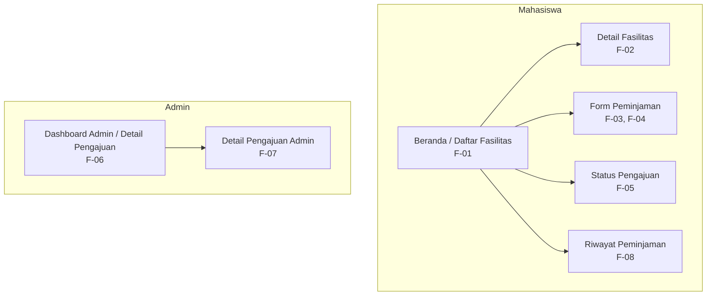

# Information Architecture — FasKampus

## 1. Deskripsi

Information Architecture (IA) FasKampus merupakan struktur yang menggambarkan susunan layar aplikasi untuk membantu mahasiswa mencari informasi fasilitas kampus, mengajukan peminjaman, dan memantau status pengajuan. IA ini disusun berdasarkan dokumen kebutuhan dan tabel pemetaan kebutuhan ke antarmuka pada Tugas 4.

FasKampus memiliki dua jenis pengguna, yaitu mahasiswa sebagai peminjam fasilitas dan admin sebagai pengelola pengajuan. Setiap layar dirancang berdasarkan kebutuhan fungsional yang telah ditentukan agar fungsi aplikasi tetap sesuai dengan proses bisnis peminjaman fasilitas kampus.

## 2. Inventaris Layar

| No. | Nama Layar | ID Kebutuhan | Prioritas | Fungsi |
|---|---|---|---|---|
| 1 | Beranda / Daftar Fasilitas | F-01 | Must have | Menampilkan daftar fasilitas kampus beserta informasi ringkas agar mahasiswa dapat menemukan fasilitas yang dibutuhkan. |
| 2 | Detail Fasilitas | F-02 | Should have | Menampilkan informasi fasilitas yang dipilih sebelum mahasiswa mengajukan peminjaman. |
| 3 | Form Peminjaman | F-03, F-04 | Must have | Menyediakan pengisian fasilitas, tanggal, jam, dan tujuan peminjaman serta menampilkan hasil pemeriksaan benturan jadwal. |
| 4 | Status Pengajuan | F-05 | Should have | Menampilkan status pengajuan mahasiswa dan alasan penolakan apabila pengajuan ditolak. |
| 5 | Dashboard Admin / Detail Pengajuan | F-06 | Must have | Menampilkan daftar dan rincian pengajuan yang masuk untuk diperiksa oleh admin. |
| 6 | Detail Pengajuan Admin | F-07 | Must have | Menyediakan informasi pengajuan dan tindakan menyetujui atau menolak, dengan alasan wajib apabila pengajuan ditolak. |
| 7 | Riwayat Peminjaman | F-08 | Could have | Menampilkan riwayat pengajuan mahasiswa beserta tanggal dan status masing-masing pengajuan. |

## 3. Diagram Information Architecture

Diagram tersebut menunjukkan pengelompokan layar berdasarkan peran pengguna. Mahasiswa menggunakan layar beranda sebagai titik awal untuk mencari fasilitas dan mengakses kebutuhan peminjaman, status, serta riwayat pengajuan. Admin menggunakan dashboard untuk memeriksa pengajuan yang masuk dan membuka detail pengajuan sebelum menentukan keputusan.

Hubungan pada diagram merupakan gambaran struktur layar, bukan urutan lengkap interaksi pengguna. Alur navigasi dan interaksi antarlayar akan dikembangkan pada Pertemuan 6.

## 4. Alasan Pemilihan Layar Utama

Layar **Beranda / Daftar Fasilitas** dipilih sebagai layar utama karena memenuhi kebutuhan F-01 yang memiliki prioritas Must have. Layar ini menjadi titik awal mahasiswa untuk menemukan fasilitas kampus dan memulai proses peminjaman, sehingga informasi fasilitas perlu ditampilkan secara jelas dan mudah dipahami.

## 5. Prinsip Perancangan

Perancangan information architecture FasKampus memperhatikan beberapa prinsip berikut:

1. **Berorientasi pada kebutuhan:** setiap layar memiliki keterkaitan dengan ID kebutuhan fungsional pada Tugas 4.
2. **Pengelompokan berdasarkan peran:** layar mahasiswa dan admin dikelompokkan sesuai tugas masing-masing.
3. **Kesederhanaan layar utama:** beranda memprioritaskan daftar fasilitas dan akses menuju proses peminjaman.
4. **Konsistensi nama layar:** nama layar dipertahankan sesuai tabel pemetaan kebutuhan ke antarmuka pada Tugas 4.
5. **Pengembangan bertahap:** kebutuhan Must have menjadi prioritas implementasi, sedangkan kebutuhan Should have dan Could have tetap dicatat dalam IA agar rancangan keseluruhan tidak kehilangan kebutuhan yang telah dianalisis.

## 6. Batasan Prototype Tugas 5

Tugas 5 berfokus pada perancangan IA, wireframe minimal dua layar, dan implementasi satu halaman utama Flutter. Oleh karena itu, beranda menjadi layar yang diimplementasikan terlebih dahulu, sedangkan layar pendukung tetap dicantumkan dalam IA sebagai dasar pengembangan berikutnya.

Pada tahap ini, diagram tidak berarti seluruh layar sudah berfungsi atau terhubung di dalam aplikasi. Implementasi navigasi, form interaktif, dan feedback antarlayar akan dilanjutkan pada Pertemuan 6.

## 7. Kesimpulan

Information architecture FasKampus disusun untuk menjaga keterkaitan antara kebutuhan pengguna, pembagian layar, dan rancangan antarmuka. Dengan beranda sebagai titik awal mahasiswa serta pengelompokan layar berdasarkan peran mahasiswa dan admin, prototype diharapkan memiliki struktur yang jelas dan dapat dikembangkan secara bertahap sesuai kebutuhan sistem.