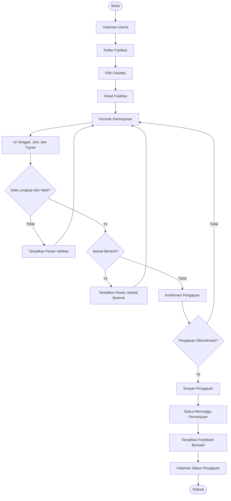

# Navigation Flow — FasKampus

## 1. Deskripsi

FasKampus merupakan aplikasi yang digunakan untuk membantu mahasiswa memperoleh informasi fasilitas kampus dan mengajukan peminjaman fasilitas. Aplikasi ini menyediakan alur untuk melihat daftar fasilitas, membuka detail fasilitas, mengisi formulir peminjaman, dan mengetahui status pengajuan.

Navigation flow dibuat agar setiap perpindahan halaman memiliki tujuan yang jelas. Interaksi pada formulir dilengkapi validasi untuk memastikan data yang dimasukkan sudah sesuai sebelum pengajuan dikirim.

## 2. Daftar Halaman

| ID | Nama Halaman | Fungsi |
|---|---|---|
| P01 | Halaman Utama | Menampilkan informasi dan daftar fasilitas kampus. |
| P02 | Daftar Fasilitas | Menampilkan fasilitas yang tersedia untuk dipinjam. |
| P03 | Detail Fasilitas | Menampilkan informasi fasilitas yang dipilih. |
| P04 | Formulir Peminjaman | Memasukkan tanggal, jam, dan tujuan peminjaman. |
| P05 | Konfirmasi Pengajuan | Menampilkan ringkasan data sebelum pengajuan dikirim. |
| P06 | Status Pengajuan | Menampilkan status pengajuan peminjaman. |

## 3. Navigation Flow

Alur utama yang digunakan adalah pengajuan peminjaman fasilitas oleh mahasiswa.

1. Mahasiswa membuka aplikasi FasKampus.
2. Aplikasi menampilkan Halaman Utama.
3. Mahasiswa memilih menu daftar fasilitas.
4. Aplikasi menampilkan Daftar Fasilitas.
5. Mahasiswa memilih salah satu fasilitas.
6. Aplikasi menampilkan Detail Fasilitas.
7. Mahasiswa memilih tombol Ajukan Peminjaman.
8. Aplikasi menampilkan Formulir Peminjaman.
9. Mahasiswa mengisi tanggal peminjaman.
10. Mahasiswa mengisi jam mulai dan jam selesai.
11. Mahasiswa mengisi tujuan peminjaman.
12. Mahasiswa menekan tombol Lanjutkan.
13. Aplikasi memeriksa kelengkapan dan validitas data.
14. Jika data valid, aplikasi memeriksa benturan jadwal.
15. Jika tidak ada benturan, aplikasi menampilkan Konfirmasi Pengajuan.
16. Mahasiswa memeriksa ringkasan pengajuan.
17. Mahasiswa menekan tombol Kirim Pengajuan.
18. Aplikasi menyimpan pengajuan dengan status Menunggu Persetujuan.
19. Aplikasi menampilkan feedback bahwa pengajuan berhasil dikirim.
20. Mahasiswa membuka Status Pengajuan untuk melihat perkembangan permohonan.

### Diagram Navigation Flow

## 4. Interaksi dan Feedback

| Interaksi | Kondisi | Feedback atau Tindakan |
|---|---|---|
| Memilih fasilitas | Fasilitas dipilih | Aplikasi membuka halaman detail fasilitas. |
| Menekan Ajukan Peminjaman | Formulir dibuka | Aplikasi menampilkan kolom tanggal, jam, dan tujuan. |
| Menekan Lanjutkan | Data belum lengkap | Aplikasi menampilkan pesan bahwa data wajib diisi. |
| Menekan Lanjutkan | Jam atau tanggal tidak valid | Aplikasi menampilkan pesan kesalahan pada input terkait. |
| Memeriksa jadwal | Jadwal bertabrakan | Aplikasi menampilkan informasi bahwa jadwal bentrok dan meminta pengguna memilih waktu lain. |
| Memeriksa jadwal | Jadwal tidak bertabrakan | Aplikasi membuka halaman konfirmasi pengajuan. |
| Menekan Kirim Pengajuan | Pengajuan dikonfirmasi | Aplikasi menyimpan pengajuan dan menampilkan pesan berhasil. |
| Membuka Status Pengajuan | Pengajuan sudah tercatat | Aplikasi menampilkan status Menunggu Persetujuan. |

### Aturan Validasi Formulir

- Fasilitas harus dipilih.
- Tanggal peminjaman harus diisi.
- Jam mulai dan jam selesai harus diisi.
- Jam selesai harus lebih akhir daripada jam mulai.
- Tujuan peminjaman harus diisi.
- Semua rentang waktu yang tumpang tindih dianggap bentrok, baik dengan peminjaman yang sudah disetujui maupun pengajuan lain yang masih menunggu.
- Pengajuan dengan jadwal bentrok tidak dapat dilanjutkan sebelum jadwal diperbaiki.

### Aturan Status Pengajuan

Pengajuan yang berhasil dikirim memiliki status awal **Menunggu Persetujuan**. Admin fasilitas dapat menyetujui atau menolak pengajuan. Jika pengajuan ditolak, admin wajib memberikan alasan penolakan. Status terbaru dan alasan penolakan ditampilkan kepada mahasiswa pada halaman Status Pengajuan.

## 5. Widget Flutter yang Digunakan

| Kebutuhan | Widget Flutter |
|---|---|
| Struktur halaman | `Scaffold` |
| Navigasi antarhalaman | `Navigator`, `MaterialPageRoute` |
| Menyusun komponen | `Column`, `Row`, `Padding` |
| Menampilkan daftar fasilitas | `ListView`, `ListTile` atau `Card` |
| Input tanggal dan waktu | `Form`, `TextFormField`, `showDatePicker`, `showTimePicker` |
| Input tujuan peminjaman | `TextFormField` |
| Tombol aksi | `ElevatedButton`, `OutlinedButton` |
| Feedback kesalahan atau keberhasilan | `SnackBar`, `AlertDialog` |
| Menampilkan status pengajuan | `Chip`, `Card`, `Text` |

## 6. Catatan Implementasi

Navigation flow ini menjadi acuan pengembangan halaman FasKampus menggunakan Flutter dan Dart. Setiap halaman harus memiliki fungsi yang jelas dan tombol yang mengarah ke tujuan sesuai alur.

Validasi formulir dapat diterapkan menggunakan `Form` dan `TextFormField`. Perpindahan halaman dapat menggunakan `Navigator.push()` dan `Navigator.pop()`, sedangkan feedback dapat diberikan menggunakan `ScaffoldMessenger` dan `SnackBar`.

Untuk implementasi awal, data fasilitas dan pengajuan dapat menggunakan data statis atau penyimpanan lokal sesuai cakupan tugas. Pemeriksaan benturan jadwal serta persetujuan dan penolakan oleh admin perlu dihubungkan dengan data pengajuan yang sama agar status dan ketersediaan fasilitas tetap konsisten.

Dokumen ini digunakan sebagai rancangan alur navigasi dan interaksi sebelum seluruh halaman dan fungsi diimplementasikan pada aplikasi FasKampus.
